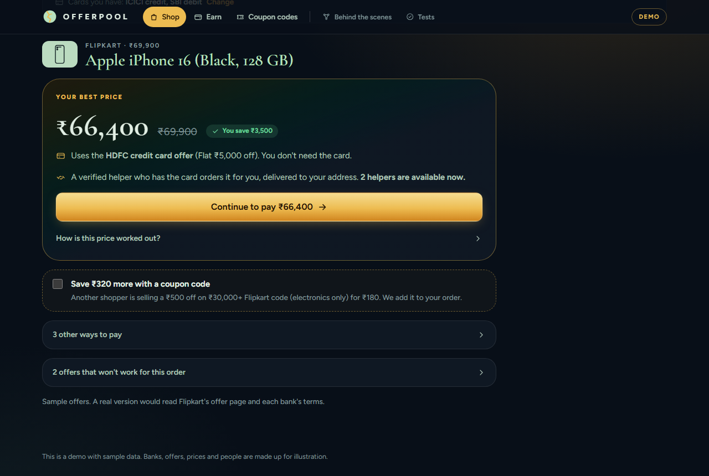
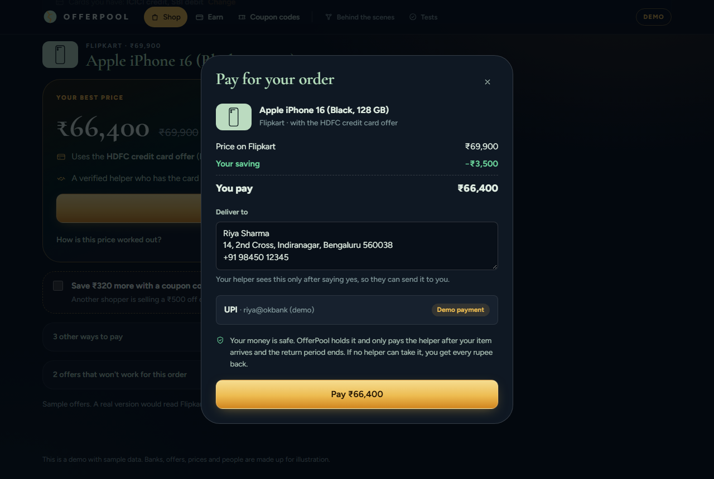
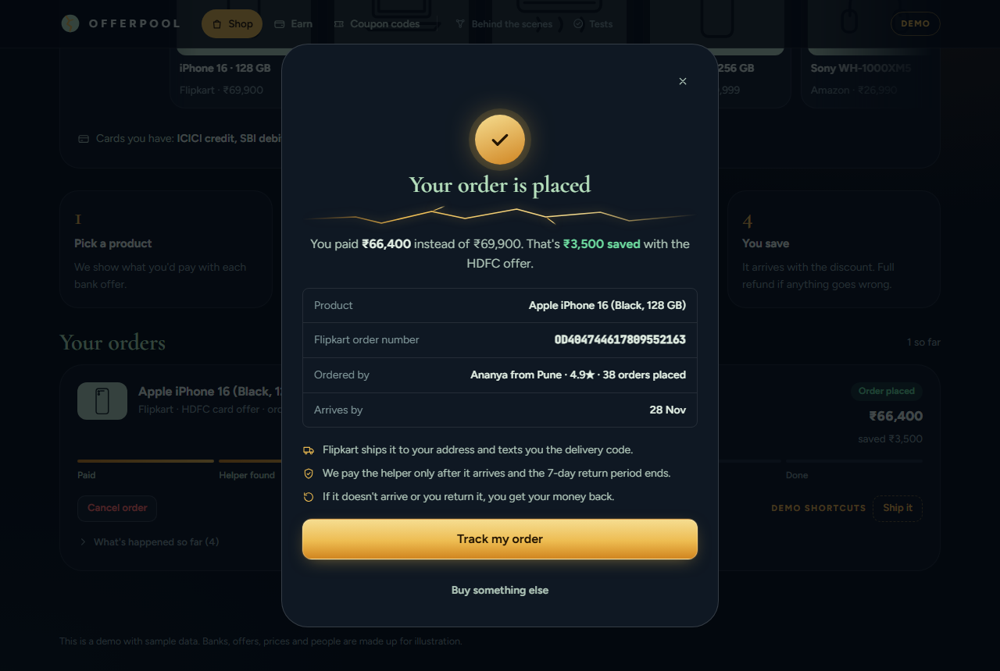
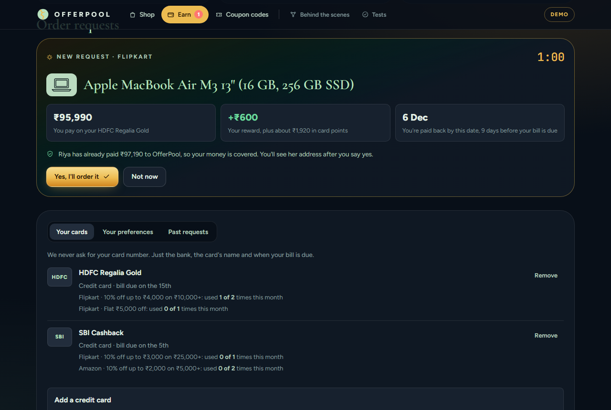
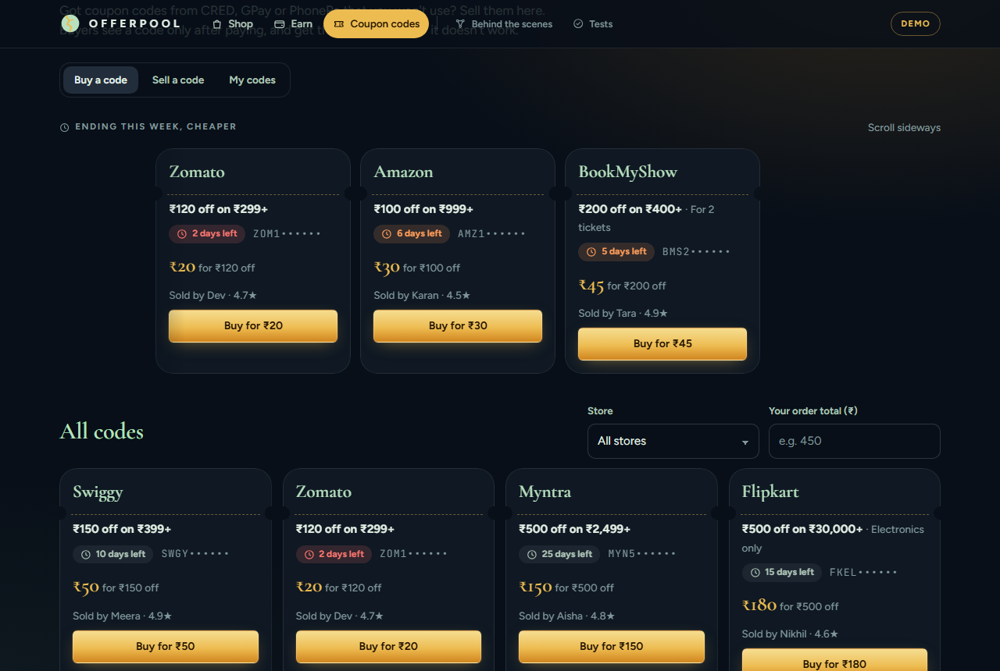
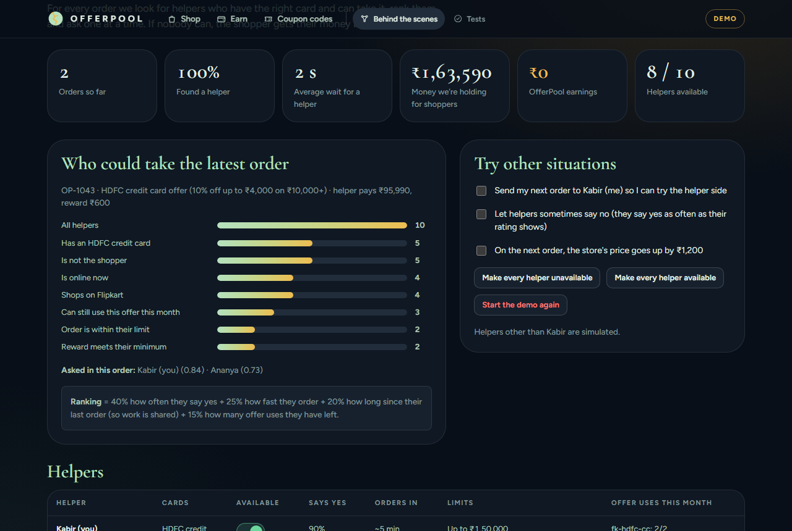
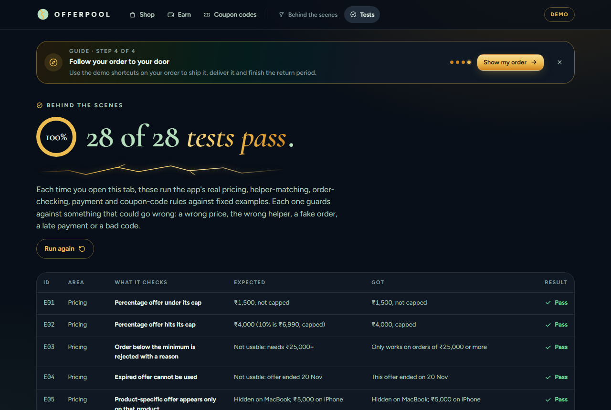
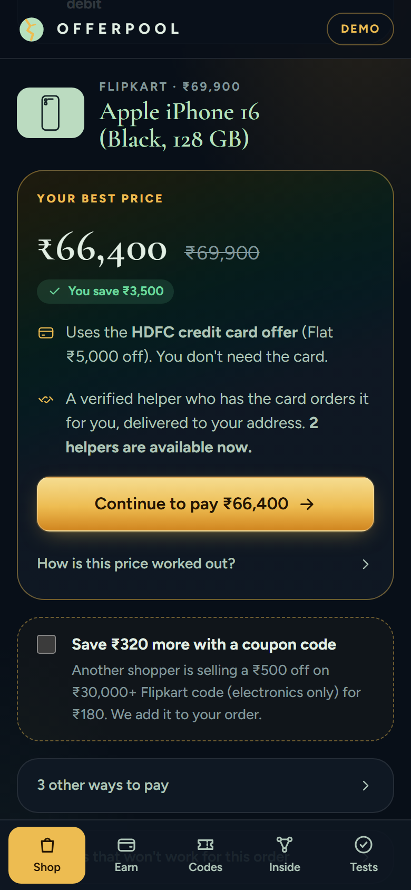
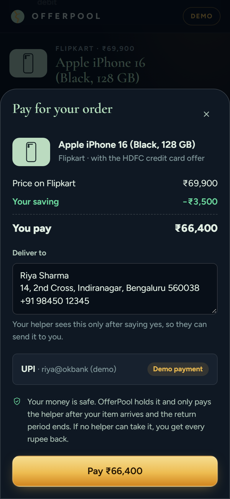

<h1 align="center">OfferPool</h1>

<p align="center"><b>Bank offers, unlocked.</b><br>
Don't have the card a deal needs? A verified helper who does buys it for you, and you keep most of the discount.</p>

<p align="center">
  <a href="https://offerpool.vercel.app"><b>Live site: offerpool.vercel.app</b></a> ·
  <a href="docs/VISION.md">Vision</a> ·
  <a href="docs/PRODUCT.md">Full description</a> ·
  <a href="docs/ARCHITECTURE.md">Architecture</a> ·
  <a href="docs/BUILD-LOG.md">How it was built</a>
</p>

<p align="center"></p>

> **Demo with sample data.** Banks, offers, prices and people are made up. Payments, deliveries and the other helpers are simulated, so the whole journey can be tried end to end.

---

## Why this exists

Online stores in India advertise offers like *"10% off with an HDFC credit card"*. The discounts are large, often ₹1,000–₹5,000 on a phone or laptop. But each one needs a specific bank's card, and most people hold one or two. Meanwhile, people with several cards leave most of their offer limits unused every month.

People already close the gap informally, by asking a friend with the right card. Between strangers that's risky, because someone has to trust someone else with ₹60,000. **OfferPool makes it safe**:
1. The shopper pays OfferPool first.
2. A helper with the right card places the order to the shopper's address.
3. The helper is paid back, with a reward, only after delivery and the return period, and always before their card bill is due.

More in **[docs/VISION.md](docs/VISION.md)**.

## How the money works

For a ₹69,900 iPhone with a flat ₹5,000 HDFC card discount:

| | |
|---|---:|
| Helper pays Flipkart (₹69,900 − ₹5,000) | ₹64,900 |
| Shopper keeps 70% of the discount | ₹3,500 |
| Helper's reward, 15% | ₹750 |
| OfferPool fee, 15% | ₹750 |
| **Shopper pays** | **₹66,400** |

If no helper can take the order, the price goes up, or the shopper cancels or returns the item, the shopper is refunded in full at once and the helper earns nothing.

## What you can do on the site

| | |
|---|---|
|  | **Shop** (you play Riya): pick a product, see your best price across every bank offer, pay in a short checkout, and watch a helper place your order live. |
|  | **Order placed** in about 5 seconds, with the order number, who placed it, the arrival date and what happens next. Then track it to delivery. |
|  | **Earn** (you play Kabir, a helper): get an order request with your reward and payback date, place the order, and pass four order checks. |
|  | **Coupon codes**: buy unused codes (revealed after paying, refunded if they don't work) or sell your own, priced automatically. |
|  | **Behind the scenes**: how a helper is chosen (seven filters, then a ranking), live numbers, every helper, an activity log, and switches to try failure cases. |
|  | **Tests**: all 28 evals running live against the site's own rules. |

<p align="center"> &nbsp; </p>

**Try it in two minutes:**
1. Open the [live site](https://offerpool.vercel.app).
2. Follow the guide bar at the top: pick the iPhone 16 → **Continue to pay** → **Pay**.
3. Open **Earn** → **Get a sample request** to see the helper's side.

## How it's built

A static site: **plain JavaScript modules, HTML and CSS**, built with **Vite**, tested with **Vitest**, hosted on **Vercel**. There's no framework, server or database. The business rules live in pure functions with no screen code, so the site and the test runner use the same rules.

```
offerpool/
├── index.html              page shell
├── src/
│   ├── main.js             screens, simulated marketplace, events
│   ├── logic.js            pricing, helper matching, order checks, payouts, coupon rules (pure)
│   ├── evals.js            the 28 evals (Tests tab + npm test)
│   ├── data.js             sample offers, products, helpers, coupon codes
│   ├── utils.js            money, dates, constants
│   └── styles.css          design system (OKLCH, dark "kintsugi" theme)
├── tests/evals.test.js     runs the evals with Vitest
├── public/favicon.svg
├── docs/                   vision, research, product, design, architecture, evals, build log
│   ├── pdf/                description (14 pp) and complete source code (42 pp) as PDFs
│   └── screenshots/
└── prototype/              the original single-file prototype
```

Details in **[docs/ARCHITECTURE.md](docs/ARCHITECTURE.md)** (with diagrams) and **[docs/DESIGN.md](docs/DESIGN.md)**.

## Run it locally

Needs Node 18 or newer.

```bash
npm install
npm run dev       # local dev server
npm test          # the 28 evals
npm run build     # production build in dist/
npm run preview   # serve the production build
```

Every push to `main` deploys to [offerpool.vercel.app](https://offerpool.vercel.app) automatically.

## How it was built

OfferPool started as a product case study: pick a real problem you've seen up close and build an app for it. It was built with Claude (Claude Code) in eight steps:
1. Understand the brief.
2. Research the market and regulation.
3. Ideate, then narrow.
4. Build a single-file prototype.
5. Redesign it.
6. Switch to plain language and a smooth checkout.
7. Turn it into a real website.
8. Write the documentation.

**[docs/BUILD-LOG.md](docs/BUILD-LOG.md)** tells the story with every prompt word for word.

## Docs

| Document | |
|---|---|
| [VISION.md](docs/VISION.md) | The problem, who it's for, principles, scope, what's next |
| [RESEARCH.md](docs/RESEARCH.md) | Competitors, economics, features, risks and regulation, ideation |
| [PRODUCT.md](docs/PRODUCT.md) | Full essay-style description of the website |
| [DESIGN.md](docs/DESIGN.md) | Design system, UI rules, language |
| [ARCHITECTURE.md](docs/ARCHITECTURE.md) | Code structure, rules, matching, order states, money flow |
| [EVALS.md](docs/EVALS.md) | 28 evals, test scenarios, bugs caught |
| [BUILD-LOG.md](docs/BUILD-LOG.md) | Timeline and every prompt used |
| [pdf/](docs/pdf/) | Description and complete source code as PDFs |

## What it isn't yet

A real launch would need:
- live offer data from stores and banks;
- payments through a licensed payment partner, since RBI rules mean OfferPool shouldn't hold customers' money itself;
- identity checks for helpers;
- per-helper volume caps to stay within store and bank rules.

See the end of [VISION.md](docs/VISION.md) and section 16 of [PRODUCT.md](docs/PRODUCT.md).
