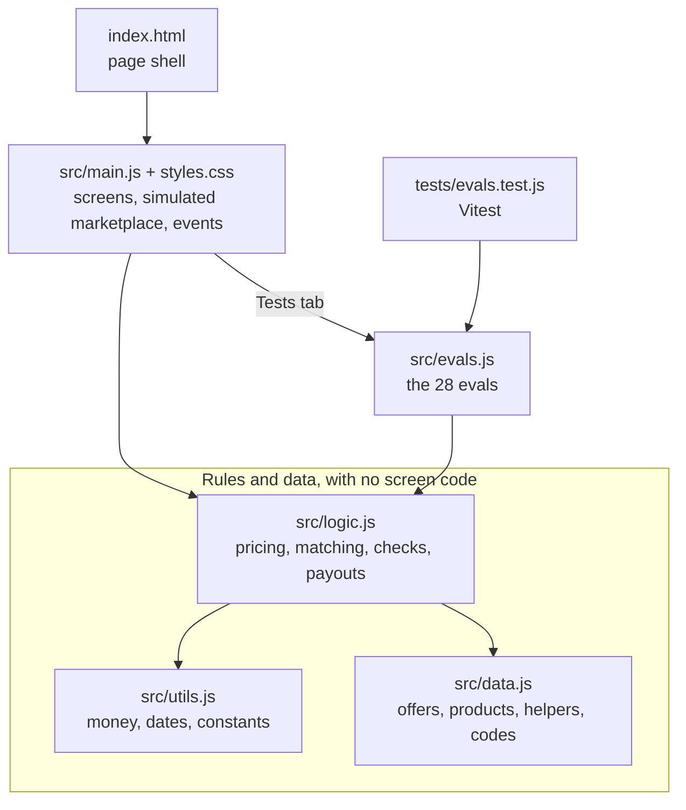
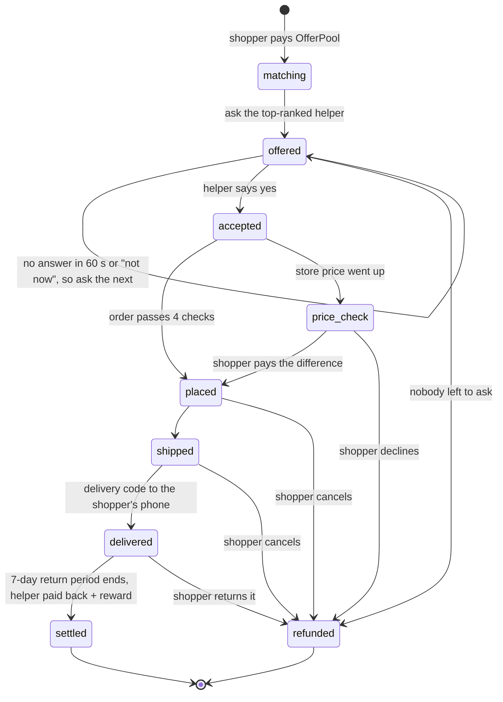
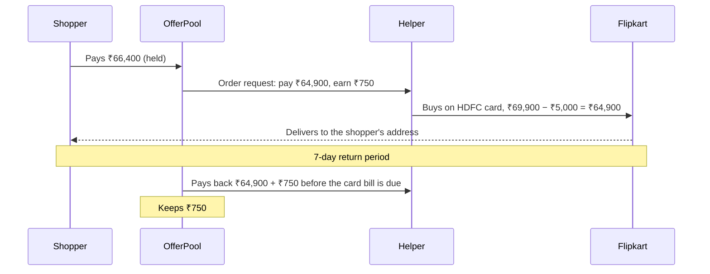

# Architecture

OfferPool is a **static website**: plain JavaScript modules, HTML and CSS, built with [Vite](https://vite.dev) and tested with [Vitest](https://vitest.dev). There's no framework, server or database; everything runs in the browser. The marketplace (the other helpers, payments, deliveries) is simulated so the whole journey can be tried end to end.

## Modules

The business rules are kept apart from the screens, so the app and the test runner use exactly the same rules.



| File | What's in it |
|---|---|
| [`index.html`](../index.html) | Page shell: header, tab bars, footer, the sheet and toast containers, fonts |
| [`src/utils.js`](../src/utils.js) | Constants (demo date, ₹400 minimum, 7-day return period, 70/15/15 split) and helpers: `fmt` for ₹ amounts, dates, HTML escaping |
| [`src/data.js`](../src/data.js) | Sample data: 6 products, 11 bank offers, Kabir (the helper you play), 9 simulated helpers, 9 coupon codes |
| [`src/logic.js`](../src/logic.js) | Pure functions for every rule (below) |
| [`src/evals.js`](../src/evals.js) | 28 evals, each `[id, area, name, check]` returning `{ pass, expected, actual }` |
| [`src/main.js`](../src/main.js) | Icons and product drawings, state, the simulated marketplace, every screen, rendering, routing and event handling |
| [`src/styles.css`](../src/styles.css) | The design system (see [DESIGN.md](DESIGN.md)) |
| [`tests/evals.test.js`](../tests/evals.test.js) | Runs each eval as a Vitest test |

## The rules (`src/logic.js`)

| Function | What it decides |
|---|---|
| `computeOffer(offer, amount, productId, today)` | Whether an offer applies and its discount: caps, minimum order, expiry, product-only offers |
| `splitDiscount(d)` | The 70/15/15 split, rounded so the three parts always add up to `d` |
| `buildOptions(product, buyerCards, pool, voucher, buyerId)` | Every way to pay. Each one is *own card* (no fee), *helper* (needs an available helper) or *not usable*, with a plain reason. Picks the cheapest usable option |
| `eligibleCardholders(pool, offer, merchant, amount, reward, buyerId)` | Runs the seven filters below and returns who is left, plus the counts after each filter |
| `scoreCandidate` / `rankCandidates` | The ranking score below |
| `verifyOrder({...})` | The four order checks: order number format, right card, shopper's address, amount within ₹10 |
| `dueDateFor` / `payoutDate` | When a helper is paid: the day after the return period, or earlier so it lands before their card bill |
| `refundOnCancel(order)` | A full, instant refund with no reward, unless the order is already finished |
| `voucherApplicable`, `suggestPrice`, `voucherFee`, `validateListing`, `resolveVoucher` | The coupon-code rules: fit to order, pricing with expiry decay, fees, listing checks, refund on a bad code |
| `parseLink(url)` | Reads a Flipkart or Amazon link, or explains why it can't |

### How a helper is chosen

Seven filters, in order. A helper must:
1. Have the right bank's credit card.
2. Not be the shopper.
3. Be available now.
4. Use that store.
5. Still have uses of the offer left this month.
6. Be willing to spend that much on one order.
7. Accept that reward.

Those left are ranked:

```
score = 0.40 × yes rate + 0.25 × speed + 0.20 × time since last order + 0.15 × offer uses left
```

The "time since last order" term spreads work around: a helper who just took an order drops down the list. Helpers are asked one at a time. A real person (Kabir) has 60 seconds to answer; then the next helper is asked. If nobody is left, the shopper is refunded.

## An order's life



## Where the money goes



## State, rendering and simulation (`src/main.js`)

- **One state object** `S` holds everything: orders, helpers, coupon codes, settings, and which panels and tabs are open.
- **Every action** changes `S` and calls `render()`. That redraws the current tab and the checkout sheet, and keeps whatever the visitor had typed in form fields and where the cursor was.
- **Simulated helpers** answer on timers: about 1.5–2.4 s to say yes, then 2.2 s to "place" the order. Their answer goes through the same `verifyOrder` check as a real helper's.
- **A one-second tick** runs Kabir's 60-second countdown.
- **Routing** uses the URL hash: `#shop`, `#earn`, `#vouchers`, `#engine`, `#evals`.
- **Storage:** only one preference, whether the guide is hidden, goes in `localStorage`. Reloading starts a fresh demo.
- **Fixed date:** the demo date is fixed to 25 Nov 2026 in `utils.js`, so offers, expiries and the evals always give the same results.

## Build and deploy

- `npm run build` produces `dist/`: about 3 kB of HTML, 33 kB of CSS and 91 kB of JS (about 37 kB gzipped).
- The GitHub repo is connected to Vercel, so every push to `main` builds and publishes [offerpool.vercel.app](https://offerpool.vercel.app) in about 10 seconds.
