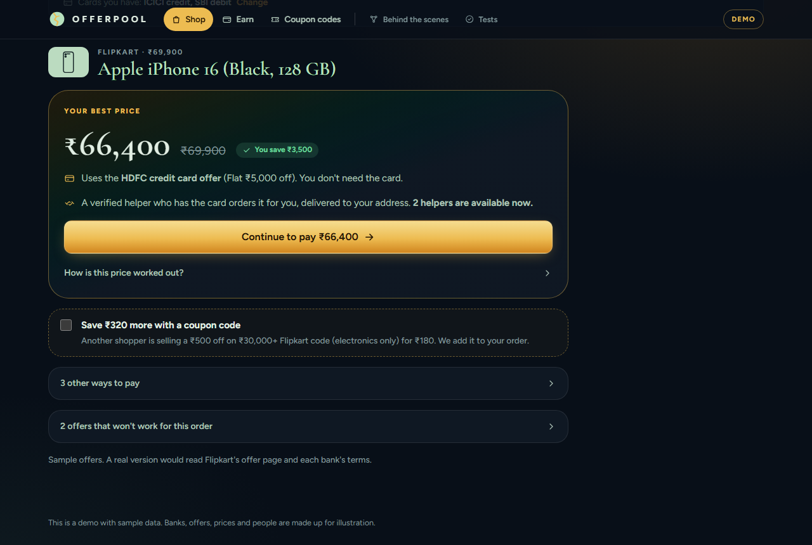
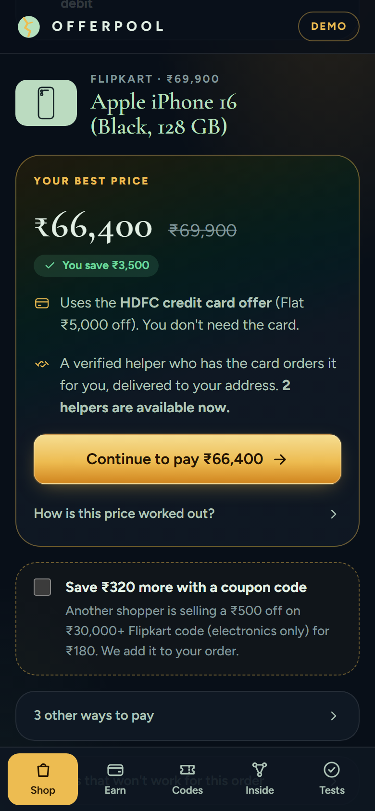
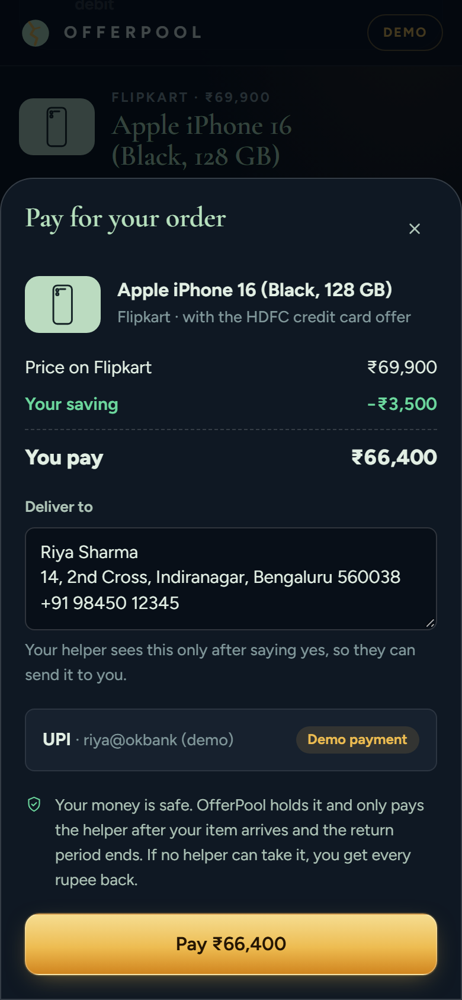

# Design

## The idea behind the look

The look comes from **kintsugi**, the Japanese craft of mending broken pottery with gold. It fits a product that "mends" offers people couldn't use. The pages are dark:
- **Ink-blue** surfaces.
- **Celadon-green** headings, like the glaze on old ceramics.
- **Gold** only for money and the one main action on each screen.

A thin gold seam line, like a mended crack, runs under each page heading and through the logo. It draws itself across the success screen when an order is placed.

## Tokens

All colours are defined in **OKLCH**, so equal lightness really looks equal. They live at the top of [`src/styles.css`](../src/styles.css).

| Token | Value | Used for |
|---|---|---|
| `--ink-0` → `--ink-3` | `oklch(0.165 0.022 255)` → `oklch(0.295 0.031 255)` | Page → cards → raised areas → hover. Lighter means higher. |
| `--celadon` | `oklch(0.87 0.065 150)` | Headings, logo |
| `--gold` | `oklch(0.82 0.135 84)` | Money, primary buttons, the current step |
| `--good` / `--warn` / `--bad` / `--info` | hues 158 / 52 / 25 / 232 | Savings, price changes, refunds, notices |
| `--line` / `--line-2` | `oklch(1 0 0 / 0.09)` / `0.16` | Borders that blend into any surface |

**Type:**
- **Cormorant Garamond** for headings and big prices.
- **Figtree** for everything else.
- **JetBrains Mono** for receipts and order numbers.

## Rules applied everywhere

| Rule | How it shows up |
|---|---|
| Nested corners: inner radius = outer radius − padding | `.panel { --rad: 30px; --pad: 22px; --rin: calc(var(--rad) - var(--pad)) }`. Every inner element uses `--rin`. |
| Borders use alpha colours | `border: 1px solid oklch(1 0 0 / 0.09)` instead of solid hex |
| Palettes in OKLCH | Every colour token |
| Gradients interpolate `in oklch` | `linear-gradient(180deg in oklch, …)` on buttons, progress bars and meters, so they don't go grey in the middle |
| Icon stroke width matches the text weight beside it | A `--sw` variable per context: 1.6 beside body text, 1.9 in tabs, 2 in buttons |
| Carousels fade at the edges | `mask: linear-gradient(90deg, transparent, black 15% 85%, transparent)` on the product and coupon rows |
| Icon swaps blur the outgoing icon | Copy buttons: the copy icon fades out with `filter: blur(4px)` as the tick fades in |
| Dark mode shows depth with lighter surfaces | Four ink levels instead of shadows |
| Full-height sections use `100dvh` | The page shell and the checkout sheet |
| Product shots on white use `mix-blend-mode: multiply` | Product drawings sit on white and blend into their celadon tiles |

## Layout

- **Desktop:** tabs along the top. The main things (Shop, Earn, Coupon codes) are separated from the behind-the-scenes tabs (Behind the scenes, Tests).
- **Phone:** a bottom tab bar within thumb reach. The checkout opens as a sheet that slides up from the bottom.

 &nbsp; 

## Language

The first version used industry words, which confused first-time users. Every one was replaced:

| Before | After |
|---|---|
| Escrow | "We hold your money safely until your order arrives" |
| Job | Order request |
| Cardholder / match | Helper / "finding a helper" |
| Commission | Reward |
| Offer quota | "Used 1 of 2 times this month" |
| Settle / return window | Done / 7-day return period |
| Engine / Evals tabs | Behind the scenes / Tests |

Error messages say what went wrong and what to do next. Offer caps are written out, e.g. "10% of ₹69,900 is ₹6,990, but this offer stops at ₹4,000".

## How the design evolved

1. **First prototype:** a light, teal-accented single page.
2. **Redesign:** the kintsugi palette and the ten rules above.
3. **Plain language and a smoother flow:** the jargon above was removed. The shopping flow became best price → checkout sheet → live "placing your order" screen → success, with no tab switching. A step-by-step guide bar was added.

The full story is in [BUILD-LOG.md](BUILD-LOG.md).
